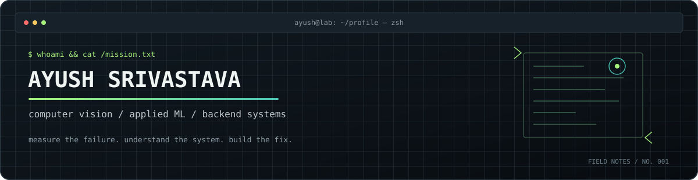
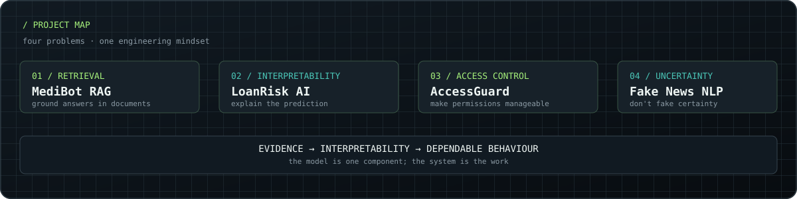

<div align="center">

<picture>
  <source media="(prefers-color-scheme: dark)" srcset="./assets/lab-header.svg">
  <source media="(prefers-color-scheme: light)" srcset="./assets/lab-header-light.svg">
  
</picture>

<br>

<a href="https://github.com/Ayushblank02"></a>
<a href="https://www.linkedin.com/in/ayush-srivastava-b34043252/"></a>

### AI/ML · Computer Vision · Backend Engineering

**I build across the stack—from a model's decision to the API that makes it useful.**

</div>

---

```text
ayush@lab:~$ cat /manifesto

I don't want a model that merely returns an answer.
I want to understand where that answer came from,
what happens when the input gets weird,
and how the whole thing behaves outside a notebook.
```

I'm an engineer interested in the seams between **applied machine learning, AI applications, and backend systems**. My projects range from retrieval-grounded question answering and explainable credit-risk modelling to NLP classification and access-governance APIs.

Different problems, same instinct: make the system understandable, test its assumptions, and don't let a polished demo hide the hard parts.

## `01 / selected builds`

Four projects. Four different engineering problems.

<table>
  <tr>
    <td width="50%" valign="top">
      <h3>◈ <a href="https://github.com/Ayushblank02/medibot-rag">MediBot RAG</a></h3>
      <p><b>Give answers a source to stand on.</b></p>
      A document-grounded medical Q&A application built around retrieval-augmented generation. The interesting work is not just calling an LLM—it's getting documents into useful chunks, retrieving relevant context, and keeping answers tied to the material.
      <br><br>
      <code>Python</code> <code>LangChain</code> <code>FAISS</code> <code>Hugging Face</code> <code>FastAPI</code>
      <br><br>
      <sub>Engineering question: did retrieval bring back the right evidence before generation began?</sub>
    </td>
    <td width="50%" valign="top">
      <h3>◈ <a href="https://github.com/Ayushblank02/loanrisk-ai">LoanRisk AI</a></h3>
      <p><b>A risk score should be explainable.</b></p>
      A credit-risk modelling project focused on imbalanced data, model evaluation, and interpreting predictions—not treating a classifier's output as a decision by itself.
      <br><br>
      <code>Python</code> <code>scikit-learn</code> <code>XGBoost</code> <code>SMOTE</code> <code>SHAP</code>
      <br><br>
      <sub>Engineering question: what is the model learning, and what evidence supports an individual prediction?</sub>
    </td>
  </tr>
  <tr>
    <td width="50%" valign="top">
      <h3>◈ <a href="https://github.com/Ayushblank02/accessguard">AccessGuard</a></h3>
      <p><b>Permissions need a lifecycle, not just a login.</b></p>
      A backend-focused access governance and recertification application. This project represents my work on service design, API boundaries, persistence, and security-oriented workflows.
      <br><br>
      <code>Java</code> <code>Spring Boot</code> <code>Spring Security</code> <code>PostgreSQL</code> <code>Docker</code>
      <br><br>
      <sub>Engineering question: can access decisions be managed and audited consistently?</sub>
    </td>
    <td width="50%" valign="top">
      <h3>◈ <a href="https://github.com/Ayushblank02/fake-news-intelligence-platform">Fake News Intelligence</a></h3>
      <p><b>Classification is not the same as certainty.</b></p>
      An NLP application for analysing article text or URLs, presenting a prediction with confidence information and token-level explanations. It includes an uncertainty path rather than forcing every input into a confident binary answer.
      <br><br>
      <code>Python</code> <code>TF-IDF</code> <code>SVM</code> <code>Streamlit</code> <code>NLP</code>
      <br><br>
      <sub>Engineering question: how should the interface respond when the model is unsure?</sub>
    </td>
  </tr>
</table>

<p align="center">
  
</p>

<details>
<summary><b>What connects these projects?</b></summary>

- **Grounding:** MediBot needs relevant source material, not just fluent generated text.
- **Interpretability:** LoanRisk and Fake News need outputs that people can inspect and question.
- **System boundaries:** AccessGuard makes API design, persistence, and authorization part of the problem.
- **User-facing behaviour:** each project has to communicate what the system knows, predicts, or permits—and where its limits are.

</details>

## `02 / my engineering range`

<table>
  <tr>
    <td width="25%" align="center" valign="top">
      <h3>AI applications</h3>
      <sub>Retrieval · grounding · LLM integration · document ingestion</sub>
    </td>
    <td width="25%" align="center" valign="top">
      <h3>Applied ML</h3>
      <sub>Feature pipelines · model evaluation · imbalance · explainability</sub>
    </td>
    <td width="25%" align="center" valign="top">
      <h3>Computer vision</h3>
      <sub>Detection tooling · localization · image evaluation · error analysis</sub>
    </td>
    <td width="25%" align="center" valign="top">
      <h3>Backend</h3>
      <sub>REST APIs · authentication · data modelling · service design</sub>
    </td>
  </tr>
</table>

I don't see these as separate boxes. A useful ML application often needs a retrieval or inference layer, a dependable API, clear data boundaries, and a way to inspect failures. I like working across those boundaries.

## `03 / tools I reach for`

<div align="center">

**Languages**


**AI / ML / Vision**


**Backend / Engineering**


</div>

## `04 / supporting work`

<details>
<summary><b>Face annotation parser · internship tooling</b></summary>

I built a face-annotation utility during my HDFC Life internship to convert manually annotated face images into ground-truth data for evaluation. It was a focused tool supporting the face-detection evaluation workflow—not a complete facial-verification product or end-to-end pipeline.

The work gave me practical exposure to annotation formats, bounding-box localization, model comparison, and the importance of reliable evaluation data.

→ [View face-annotation-parser](https://github.com/Ayushblank02/face-annotation-parser)

*The internship tool is intentionally listed as supporting work. A separate public replica pipeline may be added later, once it is built independently and is safe to publish.*

</details>

<details>
<summary><b>SwarmIntelligence · experiments</b></summary>

A smaller notebook-based space for exploring swarm-intelligence methods.

→ [View repository](https://github.com/Ayushblank02/SwarmIntelligence)

</details>

## `05 / how I debug`

```python
def investigate(failure):
    reproduce(failure)
    inspect_inputs_and_assumptions()
    isolate_the_smallest_case()
    change_one_thing()
    measure_again()
```

I prefer a failure I can explain over a metric I can't reproduce. That means looking beyond the headline score, checking the examples a system gets wrong, and being honest about uncertainty.

<details>
<summary><b>Choose your debugging build</b></summary>

| Build | Special ability |
|---|---|
| Log Reader | Reads the error before changing 14 files |
| Minimal Reproducer | Makes a vague bug small enough to understand |
| Metric Skeptic | Asks for the denominator behind a perfect score |
| Documentation Archaeologist | Finds the one sentence that explains everything |

`sudo make me_coffee` → `permission denied: caffeine not installed`

</details>

## `06 / elsewhere`

- **GitHub:** [@Ayushblank02](https://github.com/Ayushblank02)
- **LinkedIn:** [Ayush Srivastava](https://www.linkedin.com/in/ayush-srivastava-b34043252/)

<div align="center">

<sub>Four projects, different problem spaces. One recurring question: how do we know the system is doing what we think it is?</sub>

</div>

<!--
Profile maintenance:
- Keep the four primary projects above the fold.
- Keep face-annotation-parser as supporting internship tooling, not a full pipeline.
- Add the independent computer-vision replica only after it exists and is publishable.
- Verify all project claims against the repositories before adding precise metrics.
- Never publish internal employer data, private datasets, or confidential architecture.
-->
